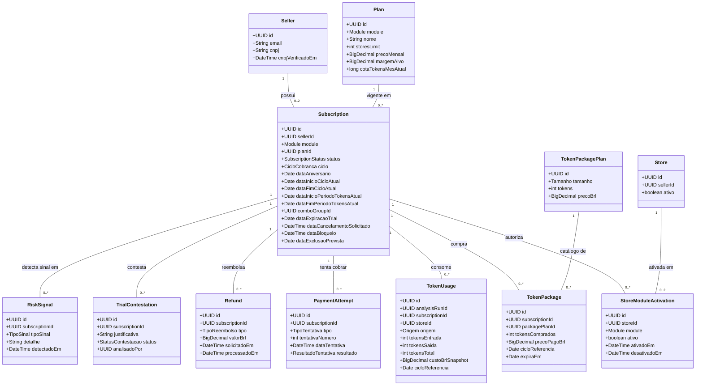
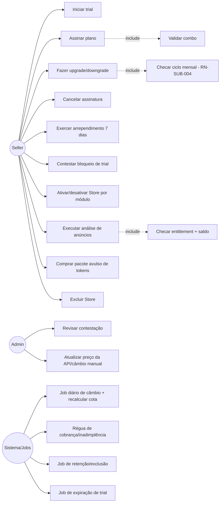
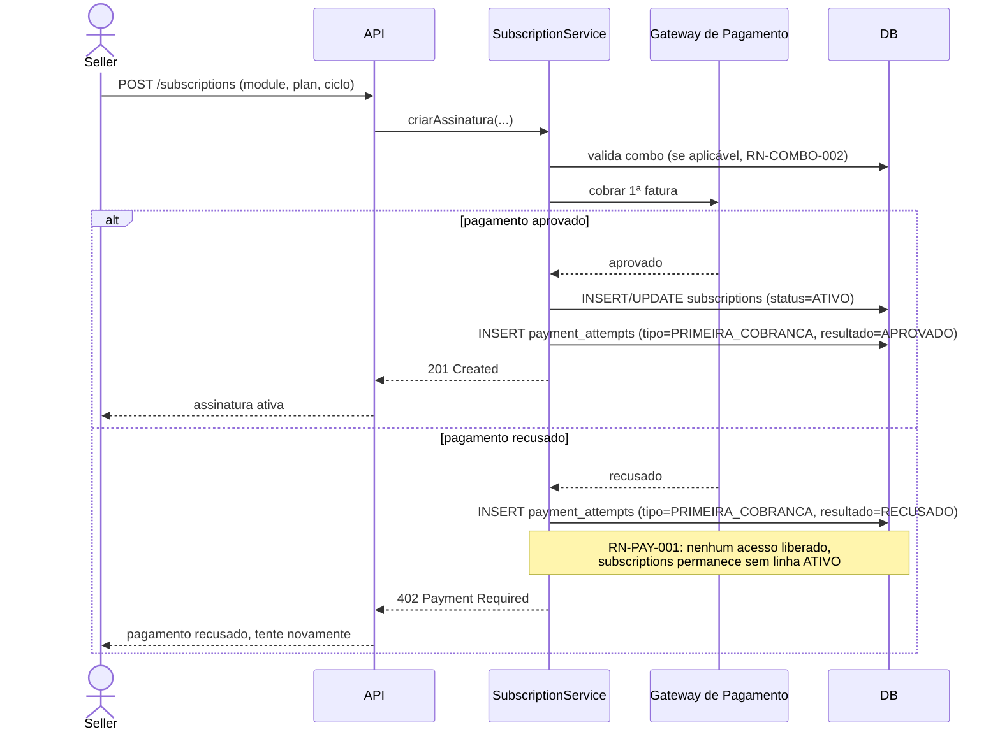
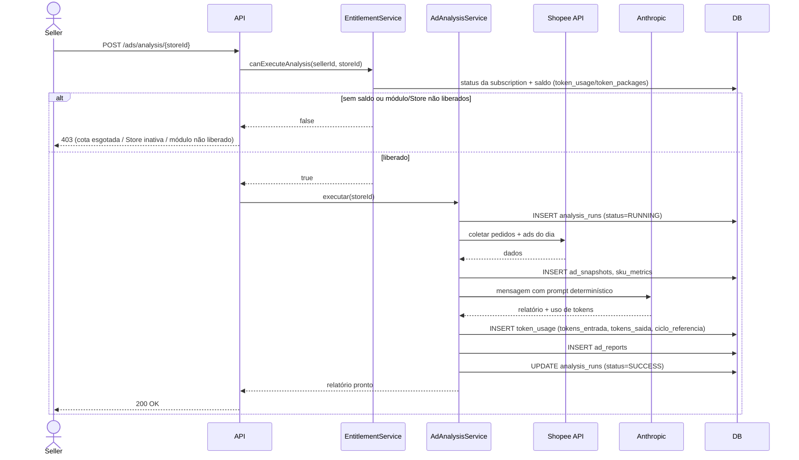
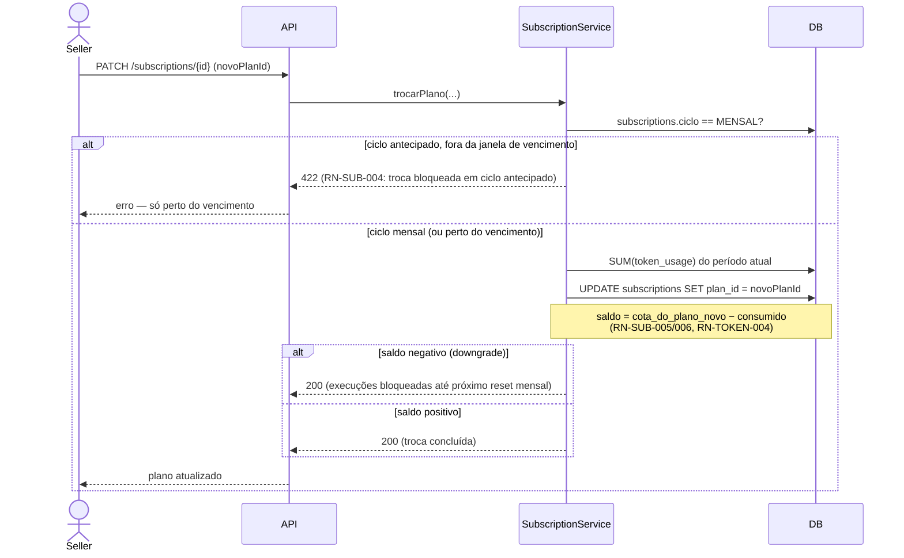
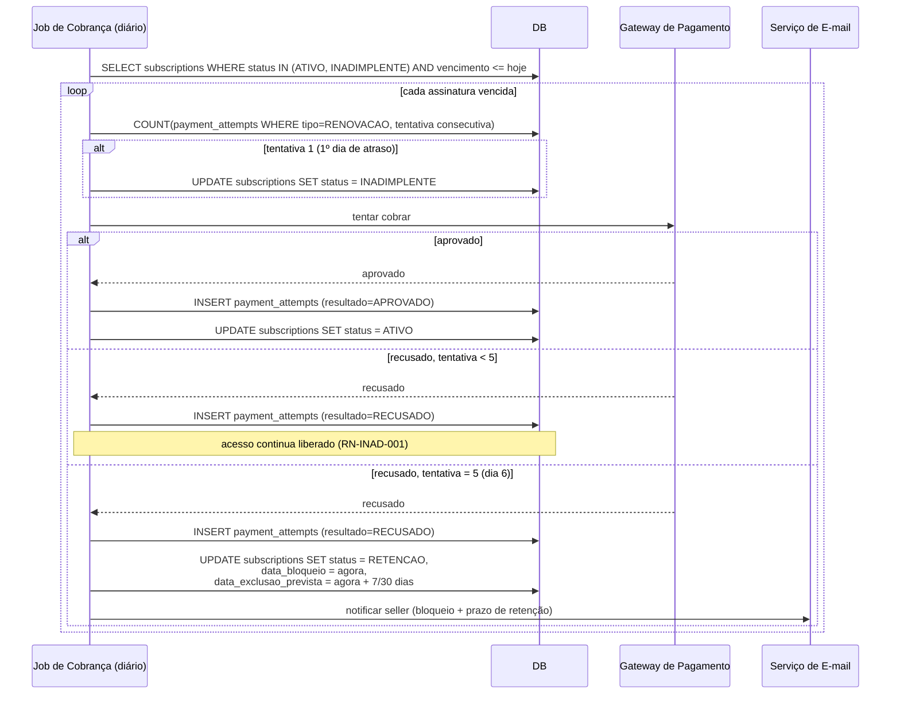
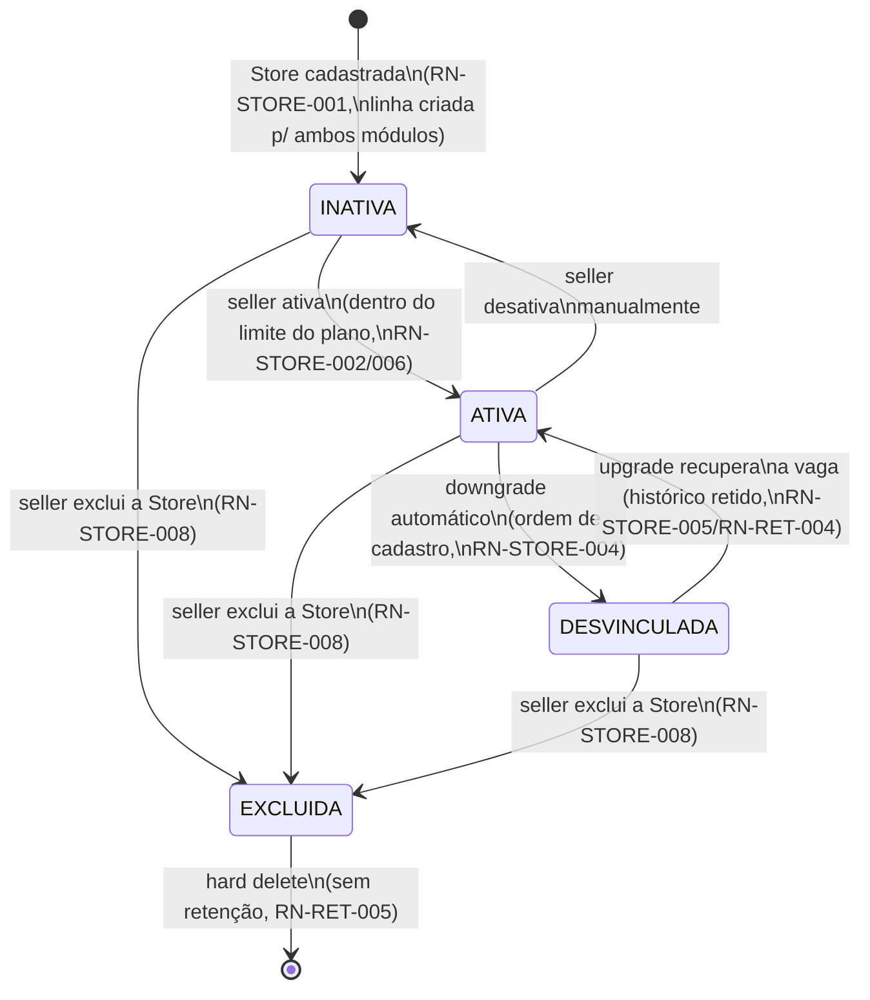
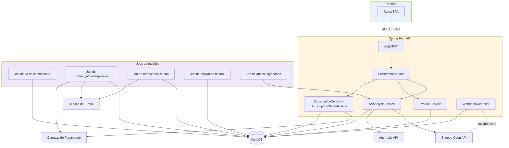

# Easy Manager — Diagramas UML

**Versão:** 1.0
**Data:** Setembro/2026
**Fonte:** `easy-manager-arquitetura-banco-de-dados.md` v2.0,
`easy-manager-software-engineering.md` v5.0,
`easy-manager-regras-negocio.md` (RN-XXX + máquina de estados §13)
**Etapa:** D do `easy-manager-plano-execucao.md` (checklist item 16)

Notação Mermaid em todos os diagramas — renderiza direto no GitHub,
GitLab, e na maioria dos editores markdown modernos.

---

## 1. Diagrama de classes — Assinaturas & Billing

Escopo: o bounded context novo desta revisão (Etapa C). `Seller`,
`Store` e `Product` aparecem só com os campos relevantes pra esse
contexto — o detalhe completo deles está nos bounded contexts próprios
(`arquitetura-banco-de-dados.md` §4–§6).

---

## 2. Diagrama de casos de uso

Mermaid não tem notação nativa de caso de uso — representado como
grafo ator↔ação, mesma informação.

---

## 3. Diagramas de sequência

### 3.1 Assinatura de plano (checkout → 1ª cobrança → ativação)

### 3.2 Execução de análise (ADS_ANALYZER)

### 3.3 Upgrade / downgrade de plano

### 3.4 Régua de inadimplência (job diário)

---

## 4. Diagramas de estados

### 4.1 Assinatura (já formalizado em `regras-negocio.md` §13 — reproduzido aqui por completude)

Ver `easy-manager-regras-negocio.md` §13.2 para o diagrama completo
(9 estados, todas as transições com RN-XXX — inclui `ARREPENDIDO`,
achado depois deste diagrama ter sido publicado; ver `regras-negocio.md`
§13.4). Não duplicado aqui pra
evitar as duas versões divergirem — **a fonte de verdade é §13 do
regras-negocio.md**, não este documento.

### 4.2 Store (cadastro → ativação por módulo → desvinculação/exclusão)

Diferente da assinatura, esta máquina não tem uma tabela de `status`
única — é a combinação de `stores.deleted_at` (soft delete) e o
`ativo`/`desativado_em` de cada linha de `store_module_activation`
(uma por módulo). O diagrama abaixo mostra o ciclo de vida de **uma
linha de `store_module_activation`**, já que é isso que efetivamente
muda de estado.

**Nota:** `DESVINCULADA` e `INATIVA` são estados de dados idênticos no
schema (`ativo=false`) — a diferença é só **como chegou lá** (downgrade
automático vs. desativação manual), preservada em `desativado_em` +
log de auditoria, não em um campo de estado separado. Aqui no diagrama
eles aparecem distintos só pra deixar as duas origens claras.

---

## 5. Diagrama de componentes / arquitetura

---

## 6. Rastreabilidade

Todos os diagramas acima usam nomes de tabela/coluna idênticos aos de
`easy-manager-arquitetura-banco-de-dados.md` v2.0 e cita RN-XXX onde
relevante — qualquer divergência entre este documento e o schema é bug
de documentação, não uma segunda fonte de verdade. Em caso de conflito:
schema (`arquitetura-banco-de-dados.md`) e regras (`regras-negocio.md`
§13) prevalecem sobre os diagramas aqui.
