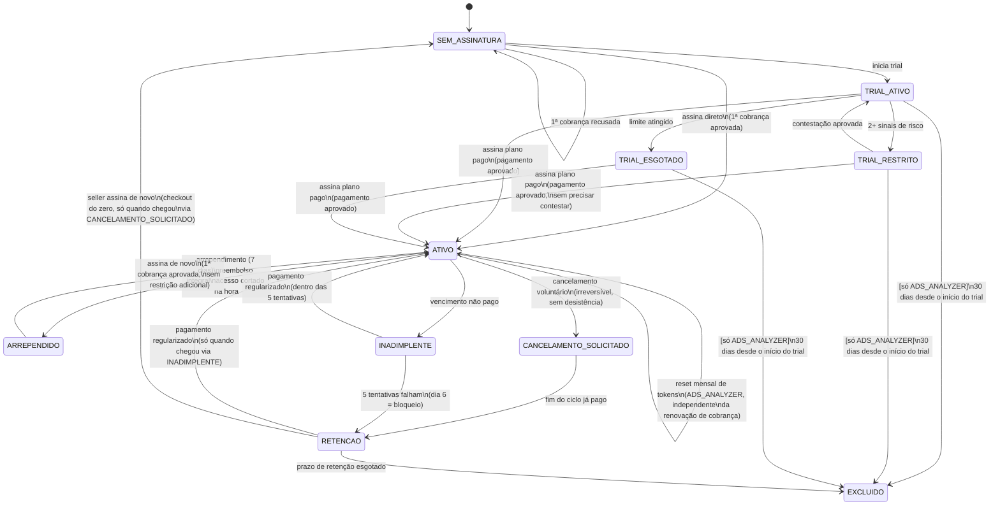

# Easy Manager — Regras de Negócio (RN-XXX)

**Versão:** 1.2 (9º estado da assinatura, `ARREPENDIDO`, adicionado —
`SEM_ASSINATURA` não é destino armazenável depois que a linha existe;
achado na implementação do Block B da Fase 1.5, junto da confirmação
de que `EXCLUIDO` é terminal sem exceção)
**Versão anterior (1.1):** RN-PAY-004, RN-SUB-009/010, RN-TOKEN-006–010
adicionadas; máquina de estados §13 formalizada e revisada; RN-SUB-004
vs RN-SUB-005/006 — contradição encontrada e resolvida; terminologia
"período de tokens" corrigida em todo o documento
**Data:** Setembro/2026
**Fonte:** `easy-manager-precificacao.md` v2.4
**Tipo:** Especificação de negócio — regras numeradas por domínio

---

## Como usar este documento

Cada regra tem um código único (`RN-DOMÍNIO-NNN`), uma descrição
objetiva e a referência da seção de origem no documento de
precificação, entre colchetes. Este documento é a ponte entre a
precificação (linguagem de negócio) e a engenharia (modelo de dados,
entitlements, testes) — cada RN aqui deve ser rastreável até um teste,
uma validação de entitlement, ou uma constraint de banco.

Nomenclatura de domínio: `PLAN`, `SUB` (Subscription), `STORE`,
`PROD` (módulo PRODUCTS), `ADS` (módulo ADS_ANALYZER), `TRIAL`,
`TOKEN`, `COMBO`, `PAY` (Pagamentos), `INAD` (Inadimplência), `RET`
(Retenção), `ABUSE` (Anti-abuso).

---

## 1. PLAN — Planos e preços

- **RN-PLAN-001**: Existem dois módulos independentes: `PRODUCTS` e
  `ADS_ANALYZER`. Cada um tem sua própria régua de planos por número
  de Stores. [§1]
- **RN-PLAN-002**: PRODUCTS tem 3 planos por Stores ativas: Básico (1,
  R$15), Intermediário (2, R$25), Completo (5, R$45). [§2]
- **RN-PLAN-003**: ADS_ANALYZER tem 3 planos por Stores ativas: Básico
  (1, R$39, margem-alvo 73%), Intermediário (2, R$69, margem-alvo
  65%), Completo (5, R$149, margem-alvo 54%). [§3.3]
- **RN-PLAN-004**: O preço mensal e a margem-alvo de cada plano
  ADS_ANALYZER são fixos e não mudam sem decisão comercial explícita.
  A cota de tokens correspondente é **derivada**, não fixa (ver
  RN-TOKEN-001). [§3.2]
- **RN-PLAN-005**: `custo_maximo_R$` de um plano ADS_ANALYZER nunca
  muda automaticamente — só a cota de tokens se ajusta para manter
  esse teto de custo constante. [§3.3]

## 2. SUB — Assinatura (Subscription)

- **RN-SUB-001**: Um seller pode assinar `PRODUCTS`, `ADS_ANALYZER`,
  ou os dois — cada módulo é uma assinatura independente, exceto
  quando comprados juntos como combo (ver domínio COMBO). [§1, §4]
- **RN-SUB-002**: O ciclo de cobrança padrão é mensal, na **data de
  aniversário da assinatura** de cada seller (não um dia fixo do mês
  igual para todos). [§5.0]
- **RN-SUB-003**: Além do mensal, o seller pode escolher ciclo
  trimestral (5% off), semestral (8% off) ou anual (12% off),
  aplicável a qualquer módulo, plano ou combo. [§4.5]
- **RN-SUB-004**: Uma vez escolhido um ciclo mais longo que o mensal,
  a troca de ciclo ou de plano fica **bloqueada durante o ciclo
  vigente** — só é possível perto do vencimento ou após vencido. Não
  há crédito nem reembolso proporcional pelo tempo não usado ao
  trocar. **Consequência direta:** o mecanismo de troca "no meio do
  caminho" das RN-SUB-005/006 abaixo só existe, na prática, pra quem
  está no ciclo mensal — pra quem está em ciclo antecipado, esta
  regra já bloqueia a troca antes de chegar lá. [§4.5]
- **RN-SUB-005**: Upgrade tem efeito imediato **(só ciclo mensal —
  RN-SUB-004 bloqueia em ciclo antecipado)**; o consumo de tokens já
  realizado no período de tokens atual é transportado/subtraído da
  cota do plano novo (sem bônus, sem perda). [§5.3]
- **RN-SUB-006**: Downgrade também tem efeito imediato **(só ciclo
  mensal — RN-SUB-004 bloqueia em ciclo antecipado)**. Se o consumo já
  realizado exceder a cota do plano novo, o saldo fica negativo e o
  acesso ao módulo é bloqueado até o **próximo reset do período de
  tokens** (mensal), voltando normalmente com a cota cheia do plano
  menor. Sem reembolso ou cota extra automática. [§5.3]
- **RN-SUB-007**: Cancelamento voluntário (sem inadimplência): o
  acesso continua até o fim do ciclo já pago (mensal, trimestral,
  semestral ou anual); não há reembolso proporcional fora do prazo de
  arrependimento. [§7.5, §8.2]
- **RN-SUB-008**: Reativação após cancelamento/inadimplência do combo
  não exige reativar os dois módulos — o seller escolhe livremente
  reativar um, outro, ou ambos, pagando preço avulso se reativar
  separadamente. [§4]
- **RN-SUB-009**: O cancelamento voluntário (`CANCELAMENTO_SOLICITADO`)
  é **irreversível** — uma vez solicitado, não há como desistir e
  voltar direto para `ATIVO`. O acesso segue normalmente até o fim do
  ciclo já pago, depois entra em retenção.
- **RN-SUB-010**: Voltar de `RETENÇÃO` para `ATIVO` quando se chegou
  lá por **cancelamento voluntário** (não por inadimplência) exige
  **checkout completo do zero** — mesmo com os dados ainda existindo
  dentro da janela de retenção, não há reativação simplificada.
  Diferente do caso de inadimplência (RN-RET-003), onde regularizar o
  pagamento reativa a mesma assinatura sem novo checkout.

## 3. STORE — Cadastro e ativação de Stores

- **RN-STORE-001**: O cadastro de Store é único por seller (não
  duplicado por módulo). O teto de cadastro é o **maior** entre os
  limites de Stores ativas dos módulos assinados. [§6]
- **RN-STORE-002**: Dentro do total cadastrado, cada módulo aplica seu
  próprio limite de Stores **ativas**, que pode ser menor que o total
  cadastrado. [§6]
- **RN-STORE-003**: Stores contam pelo total agnóstico de marketplace
  (Shopee, TikTok Shop, Shein etc. somam juntas). [§6]
- **RN-STORE-004**: Em downgrade, se o seller não escolher
  manualmente, a desvinculação de Stores segue **ordem de cadastro**
  (mais recentes desvinculadas primeiro). O seller pode escolher
  manualmente a qualquer momento; ao desvincular uma do meio, as mais
  novas que ainda cabem no limite sobem de posição e ficam ativas no
  lugar dela. [§6]
- **RN-STORE-005**: Histórico de Store desvinculada por downgrade fica
  **retido**, não excluído — permitindo reincluir com histórico
  intacto em upgrade futuro. [§6, §11]
- **RN-STORE-006**: A escolha de quais Stores ficam ativas em um
  módulo (quando cadastradas > limite ativo do plano) é feita pelo
  seller diretamente na aba do módulo, e pode ser trocada a qualquer
  momento respeitando o limite vigente. [§6]
- **RN-STORE-007**: A ativação de Store por módulo é um campo
  separado de `stock_sync_status` (webhooks de estoque do PRODUCTS) —
  não devem ser confundidos. [§6]
- **RN-STORE-008**: Exclusão de Store pelo **próprio seller** (fora do
  fluxo de downgrade) exige aviso explícito de que os dados serão
  **excluídos** (não retidos). A exclusão é imediata e definitiva, sem
  carência, e a vaga no teto de cadastro libera na hora. [§6]

## 4. PROD — Módulo PRODUCTS

- **RN-PROD-001**: Custo de operação é fixo por seller, não escala com
  uso — preço compete por número de Stores, não por volume de
  produtos. [§2]
- **RN-PROD-002**: Trial de PRODUCTS: sem cartão, limite de **15
  produtos cadastrados em 1 Store**, sem limite de tempo. [§7.0]
- **RN-PROD-003**: Ao tentar cadastrar o 16º produto ou uma 2ª Store
  no trial, o sistema bloqueia a ação e direciona para upgrade. [§7.0]
- **RN-PROD-004**: O trial de PRODUCTS aplica a mesma verificação
  anti-abuso (CNPJ + score de risco) do trial de ADS_ANALYZER. [§7.0]

## 5. ADS — Módulo ADS_ANALYZER

- **RN-ADS-001**: Custo de operação escala com tokens de IA
  consumidos por execução; preço reflete exclusividade de nicho. [§1]
- **RN-ADS-002**: Cada plano tem cota de tokens mensal como teto
  adicional sobre o limite de 1 execução manual por Store por dia (já
  definido na engenharia). A cota não substitui esse limite. [§3.2]
- **RN-ADS-003**: Ao esgotar a cota, novas execuções são bloqueadas
  para o resto do **período de tokens** vigente (mensal), com CTA de
  upgrade ou compra de pacote avulso — nunca bloqueio seco sem
  explicação. [§5.1]
- **RN-ADS-004**: Aviso preventivo ao atingir **~80%** de consumo da
  cota, antes do esgotamento total. [§5.1]
- **RN-ADS-005**: A qualidade da análise pode crescer com o tempo de
  permanência do seller (histórico acumulado) — não implementado no
  MVP, roadmap futuro. [§9]

## 6. TRIAL — Trial gratuito (ADS_ANALYZER)

- **RN-TRIAL-001**: Trial concede **3 execuções reais** do pipeline,
  sem cartão de crédito, gerando relatório pela própria plataforma.
  [§7.1]
- **RN-TRIAL-002**: O relatório do trial é **parcial**: libera resumo
  executivo, tabela comparativa e top performers; bloqueia SKUs de
  atenção, oportunidades, riscos e plano de ação (com CTA de
  assinatura). [§7.1]
- **RN-TRIAL-003**: O trial usa um **prompt de IA dedicado**, separado
  do prompt pago — não envia ao modelo as heurísticas das seções
  bloqueadas, e o modelo nunca gera essas seções (economia real de
  tokens de entrada e saída, não apenas ocultação visual). [§7.2]
- **RN-TRIAL-004**: Cota de tokens do trial: **60.000 tokens no
  total** para as 3 execuções, isolada da cota dos planos pagos.
  [§7.3]
- **RN-TRIAL-005**: Quando os dois limites do trial conflitam (3
  execuções vs. 60.000 tokens), o **teto de tokens sempre prevalece**
  — uma execução é cortada/bloqueada antes de rodar se ultrapassaria o
  total, mesmo antes de completar as 3. O seller vê barra de
  progresso do consumo do trial. [§7.3]
- **RN-TRIAL-006**: Snapshots de conta trial expiram e são excluídos
  automaticamente **30 dias** após a criação, se o seller não assinar
  um plano pago do ADS_ANALYZER até então. Se assinar dentro do prazo,
  os snapshots passam a contar como histórico normal (não expiram
  mais). [§8.1]
- **RN-TRIAL-007**: A cota gratuita de execuções (RN-TRIAL-001)
  substitui totalmente a exportação de dados brutos como forma de
  trial — não há mais essa alternativa. [§7.4]
- **RN-TRIAL-008**: Contas trial não são excluídas do banco mesmo após
  esgotarem a cota — permanecem persistidas para que CNPJ e sinais de
  risco fiquem registrados contra uma nova tentativa. [§7.4]
- **RN-TRIAL-009**: O trial de ADS_ANALYZER tem limite de **1 Store**
  ativa no módulo — mesmo teto do seu próprio plano Básico pago, não
  do trial de PRODUCTS (RN-PROD-002, que é um limite diferente, de
  outro módulo). O freio real do trial de ADS_ANALYZER continua sendo
  tokens/execuções (RN-TRIAL-004/005), não Store — este limite existe
  só pra manter `getStoreLimit` bem definido em todo estado da
  assinatura, sem deixar um buraco. **Achado e confirmado na revisão
  do Block C da Fase 1.5** — antes disso, nenhum documento definia
  esse valor.

- **RN-TOKEN-001**: A cota de tokens mensal de cada plano pago **não é
  fixa** — é calculada dinamicamente:
  `custo_maximo_R$ = preco_mensal × (1 − margem_alvo)`;
  `cota_tokens_mes = custo_maximo_R$ / custo_por_token_atual`. [§3.2]
- **RN-TOKEN-002**: Job automático **diário** busca o câmbio USD/BRL
  vigente e recalcula a cota de todos os planos. O preço da API da
  Anthropic fica fixo até atualização manual no sistema (sem checagem
  em tempo real por chamada). [§3.2]
- **RN-TOKEN-003**: Pacote avulso de tokens (Extra P/M/G) tem preço
  por token = 3x o preço por token do plano Básico. Tokens expiram ao
  final do **período mensal de tokens** vigente, junto com a cota
  normal — não acumulam para o mês seguinte. [§5.2]
- **RN-TOKEN-004**: Em troca de plano no meio do período de tokens
  (**só ciclo de cobrança mensal** — RN-SUB-004 bloqueia troca de
  plano em ciclo antecipado), o saldo disponível após a troca é
  `cota_do_plano_novo − tokens_já_consumidos_no_período_atual` — sem
  bônus, sem perda do já consumido. [§5.3]
- **RN-TOKEN-005**: A cota de tokens do ADS_ANALYZER continua
  resetando **mensalmente**, mesmo dentro de um ciclo de cobrança
  antecipado (trimestral/semestral/anual) — é um período próprio,
  independente da data de renovação da cobrança (schema: Etapa C11,
  `subscriptions.data_inicio_periodo_tokens_atual`). [§4.5]
- **RN-TOKEN-006**: `custo_por_token_atual` é uma **média ponderada**
  entre o preço de entrada e de saída da Anthropic (saída custa ~5x
  mais), não um valor único. Estimativa inicial: proporção ~2:1
  entrada:saída (12.500/6.000 tokens por execução, ponto médio da
  faixa do documento de engenharia do Shopee Ads Analyzer). Após um
  volume mínimo de execuções reais (referência: 100), o sistema
  **recalibra automaticamente** essa proporção com base na média real
  medida, sem intervenção manual, e continua recalibrando
  periodicamente conforme mais dados se acumulam. [§3.2]
- **RN-TOKEN-007**: Qualquer cálculo de tokens que resulte em valor
  fracionário (cota mensal, saldo restante, saldo transportado em
  upgrade/downgrade) é sempre **arredondado para baixo** (piso), nunca
  para o inteiro mais próximo — critério conservador que garante que
  o custo real nunca ultrapasse o teto de margem prometido. [§3.2]
- **RN-TOKEN-008**: Cada atualização manual do preço da API da
  Anthropic é registrada com histórico versionado (data da mudança,
  valor anterior, valor novo) — não é substituição simples. O cálculo
  do dia a dia sempre usa o valor vigente; o histórico serve só para
  auditoria/consulta, nunca influencia o cálculo corrente. [§3.2]
- **RN-TOKEN-009**: O sistema controla saldo e cota **em tokens**,
  fonte de verdade única — nunca em R$. O R$ equivalente é apenas um
  snapshot histórico por execução (calculado com câmbio/preço do
  momento), usado só para relatórios e auditoria de custo real; nunca
  para decidir se uma execução pode rodar. [§3.2]
- **RN-TOKEN-010**: Os preços em R$ dos pacotes avulsos (Extra P/M/G)
  são **fixos**, não recalculam automaticamente com a variação diária
  de câmbio — diferente da cota mensal dos planos. Revisão é manual,
  feita junto com a atualização manual do preço da API da Anthropic.
  [§5.2]

## 8. COMBO — PRODUCTS + ADS_ANALYZER combinados

- **RN-COMBO-001**: Combo dá 15% de desconto sobre a soma dos dois
  módulos avulsos, no mesmo par de Stores. [§4]
- **RN-COMBO-002**: O desconto de combo só se aplica quando os dois
  módulos são assinados **juntos, no mesmo ato**. Assinaturas em
  momentos diferentes pagam preço avulso cheio no módulo novo, sem
  desconto retroativo. [§4]
- **RN-COMBO-003**: Dentro dos 7 dias de arrependimento, o seller pode
  cancelar **apenas um** dos dois módulos do combo, mantendo o outro
  ativo. O módulo cancelado é reembolsado integralmente (proporcional
  à sua fatia no combo); o módulo mantido perde o desconto de combo a
  partir da **próxima renovação**. [§4]
- **RN-COMBO-004**: Fora dos 7 dias, cancelar um dos dois módulos do
  combo faz o módulo mantido perder o desconto de combo na renovação
  seguinte, sem reembolso do período já pago. [§4]

## 9. PAY — Pagamentos

- **RN-PAY-001**: Falha na **cobrança inicial** (ato da assinatura,
  sem ciclo pago anterior): a conta **não ativa nenhum acesso** até o
  pagamento ser aprovado. Não se aplica a régua de tolerância. [§8.15]
- **RN-PAY-002**: Direito de arrependimento de 7 dias corridos (art.
  49 CDC): reembolso integral, sem justificativa, mesmo que já tenha
  consumido tokens da cota — a perda é absorvida pela operação. [§7.5]
- **RN-PAY-003**: Fora dos 7 dias, cancelamento não gera reembolso
  proporcional pelo período já pago — acesso segue até o fim do ciclo.
  [§7.5]
- **RN-PAY-004**: Ao exercer o direito de arrependimento, o acesso ao
  módulo é **cortado imediatamente**, no momento do pedido — não
  espera o fim do dia, do ciclo, ou qualquer outro marco.

## 10. INAD — Inadimplência

- **RN-INAD-001**: A partir do vencimento não pago (assinatura já
  ativa, com pelo menos um ciclo pago com sucesso antes), o sistema
  tenta cobrança automaticamente **1x/dia por 5 dias corridos**, com
  acesso **liberado normalmente** durante esse período. [§8.15]
- **RN-INAD-002**: Se as 5 tentativas falharem, no **6º dia** o acesso
  ao módulo é bloqueado (mesmo comportamento de cancelamento, sem
  excluir dados ainda). [§8.15]
- **RN-INAD-003**: O prazo de retenção de dados (RN-RET-001) começa a
  contar **a partir do bloqueio** (dia 6), não do vencimento original.
  [§8.15]
- **RN-INAD-004**: No combo, a régua de inadimplência vale **por
  módulo**, cada um com seu próprio relógio e aviso. [§8.2]

## 11. RET — Retenção de dados

- **RN-RET-001**: Prazo de retenção após cancelamento/inadimplência,
  diferenciado por módulo: **PRODUCTS = 30 dias**, **ADS_ANALYZER = 7
  dias**. [§8.2]
- **RN-RET-002**: Em cancelamento **voluntário** (sem inadimplência), a
  contagem do prazo de retenção só começa **a partir do fim do ciclo
  já pago** — nunca no momento do pedido de cancelamento. Vale para
  qualquer ciclo (mensal, trimestral, semestral, anual). [§8.2]
- **RN-RET-003**: Se o pagamento for regularizado dentro do prazo de
  retenção, os dados continuam intactos. Esgotado o prazo, a exclusão
  é permanente, sem segunda tolerância. [§8.2]
- **RN-RET-004**: Histórico de Store desvinculada por downgrade fica
  retido indefinidamente (não tem prazo de expiração) — diferente da
  retenção por cancelamento/inadimplência de assinatura. [§6, §11]
- **RN-RET-005**: Exclusão de Store pelo próprio seller é imediata e
  definitiva — **não** segue o prazo de retenção de 7/30 dias (esse
  prazo é só para cancelamento/inadimplência da assinatura como um
  todo). [§6]

## 12. ABUSE — Anti-abuso (trial)

- **RN-ABUSE-001**: Verificação de CNPJ via Receita Federal, sem
  exigir CPF do titular. [§7.4]
- **RN-ABUSE-002**: Score de risco combina sinais — nenhum sinal
  isolado bloqueia sozinho; **2 ou mais sinais coincidentes** disparam
  restrição automática. Sinais: device fingerprint, e-mail/celular já
  usado, IP/rede (sinal de apoio, não decisivo isolado), limite de
  contas trial por dispositivo em janela de tempo (ex: 1 a cada 90
  dias). [§7.4]
- **RN-ABUSE-003**: Ao bater 2+ sinais, a conta é restrita
  **automaticamente** (trial bloqueado); o sistema envia e-mail de
  notificação para acompanhamento — sem fila de revisão manual por
  padrão. [§7.4]
- **RN-ABUSE-004**: Conta restrita vê tela de bloqueio com botão
  **"contestar bloqueio"** — abre revisão manual só quando o próprio
  seller contesta, cobrindo falsos positivos (ex: cônjuge com CNPJ
  próprio). [§7.4]
- **RN-ABUSE-005**: Camada de filtros baratos: rate limit de criação
  de conta por IP, confirmação de e-mail obrigatória antes da 1ª
  execução, bloqueio de domínios de e-mail descartável, atraso
  proposital na liberação da 1ª execução real. [§7.4]
- **RN-ABUSE-006**: Monitoramento de taxa de conversão trial → pago;
  queda abrupta abaixo de ~5% com crescimento desproporcional de
  contas trial é sinal de abuso em massa a investigar. [§7.4]

---

## Invariantes do sistema

Coisas que o sistema **nunca** pode permitir, independente de bug,
edge case ou ordem de operações:

1. **Nunca** permitir mais Stores **ativas** em um módulo do que o
   limite do plano vigente daquele módulo (RN-STORE-002).
2. **Nunca** permitir mais Stores **cadastradas** no total do que o
   maior limite entre os módulos assinados (RN-STORE-001).
3. **Nunca** processar uma execução de ADS_ANALYZER (trial ou pago)
   que resultaria em consumo de tokens acima da cota disponível no
   período de tokens vigente — a checagem de saldo é **antes** de
   chamar a API, não depois (RN-ADS-003, RN-TRIAL-005).
4. **Nunca** cobrar o preço de combo por módulos assinados em
   momentos diferentes (RN-COMBO-002).
5. **Nunca** liberar acesso a um módulo pago cuja **primeira cobrança**
   falhou (RN-PAY-001) — diferente de inadimplência em assinatura já
   ativa, onde o acesso é liberado durante as tentativas
   (RN-INAD-001).
6. **Nunca** excluir dados de PRODUCTS ou ADS_ANALYZER antes de
   esgotado o prazo de retenção aplicável (30 ou 7 dias) — e essa
   contagem nunca pode começar antes do ponto correto definido por
   caso (fim do ciclo pago em cancelamento voluntário; dia do bloqueio
   em inadimplência) (RN-RET-002, RN-INAD-003).
7. **Nunca** aplicar o direito de arrependimento (reembolso 7 dias)
   mais de uma vez para a mesma contratação de módulo (RN-PAY-002).
8. **Nunca** permitir troca de ciclo de pagamento (mensal ↔
   trimestral/semestral/anual) ou de plano no meio de um ciclo
   antecipado já pago, fora da janela perto do vencimento
   (RN-SUB-004).
9. **Nunca** deixar o saldo de tokens negativo sem bloquear o acesso
   ao módulo — downgrade com saldo negativo bloqueia até o próximo
   reset do período de tokens (RN-SUB-006).
10. **Nunca** restringir automaticamente uma conta trial por apenas
    **um** sinal de risco isolado — exige 2+ sinais coincidentes
    (RN-ABUSE-002).
11. **Nunca** expor, no prompt do trial, as heurísticas de diagnóstico
    das seções bloqueadas (RN-TRIAL-003) — risco de vazamento de
    conteúdo pago via texto gerado.
12. **Nunca** excluir snapshots de Store desvinculada por downgrade —
    só Stores excluídas manualmente pelo seller têm exclusão
    definitiva de dados (RN-RET-004 vs. RN-RET-005).

---

## 13. Máquina de estados da assinatura

A máquina é **por módulo assinado** (PRODUCTS e ADS_ANALYZER têm cada
um a sua instância desta máquina, mesmo quando comprados juntos como
combo) — consistente com RN-INAD-004, onde a régua de inadimplência
roda separadamente por módulo dentro do combo.

### 13.1 Estados

| Estado | Significado |
|---|---|
| `SEM_ASSINATURA` | Seller nunca assinou o módulo, ou teve assinatura excluída definitivamente |
| `TRIAL_ATIVO` | Em trial gratuito, dentro dos limites (RN-PROD-002, RN-TRIAL-001) |
| `TRIAL_RESTRITO` | Trial bloqueado por score de risco (RN-ABUSE-003) |
| `TRIAL_ESGOTADO` | Limite do trial atingido (produtos/Stores ou execuções/tokens) |
| `ATIVO` | Assinatura paga, em dia |
| `INADIMPLENTE` | Vencimento não pago, dentro da régua de 5 tentativas (RN-INAD-001) |
| `RETENCAO` | Acesso bloqueado, contando o prazo de retenção (7 ou 30 dias) — chegada por inadimplência (dia 6) ou por fim de ciclo após cancelamento voluntário |
| `EXCLUIDO` | Dados apagados definitivamente (terminal, sem exceção — confirmado na Fase 1.5, Block B) |
| `ARREPENDIDO` | Direito de arrependimento exercido (7 dias, reembolso integral); linha mantida (nunca é hard-delete), mas sem plano — precisa assinar de novo pra voltar |

### 13.2 Diagrama

### 13.3 Tabela de transições (com RN de origem)

| Origem | Evento/gatilho | Destino | Condição/guarda | RN |
|---|---|---|---|---|
| `SEM_ASSINATURA` | Seller inicia trial | `TRIAL_ATIVO` | Módulo elegível a trial (ambos são) | RN-PROD-002, RN-TRIAL-001 |
| `SEM_ASSINATURA` | Seller assina plano pago | `ATIVO` | 1ª cobrança aprovada | RN-PAY-001 |
| `SEM_ASSINATURA` | Seller assina plano pago | `SEM_ASSINATURA` (permanece) | 1ª cobrança recusada — nenhum acesso liberado | RN-PAY-001 |
| `TRIAL_ATIVO` | 2+ sinais de risco coincidentes | `TRIAL_RESTRITO` | — | RN-ABUSE-002/003 |
| `TRIAL_RESTRITO` | Seller contesta e revisão manual aprova | `TRIAL_ATIVO` | — | RN-ABUSE-004 |
| `TRIAL_ATIVO` | Limite do trial atingido | `TRIAL_ESGOTADO` | PRODUCTS: 16º produto ou 2ª Store. ADS_ANALYZER: teto de tokens (60k) prevalece sobre nº de execuções | RN-PROD-003, RN-TRIAL-005 |
| `TRIAL_ATIVO`, `TRIAL_RESTRITO` ou `TRIAL_ESGOTADO` | Seller assina plano pago | `ATIVO` | Pagamento aprovado — vale mesmo em `TRIAL_RESTRITO`, sem precisar contestar/esperar revisão primeiro | RN-PAY-001 |
| `TRIAL_ATIVO`, `TRIAL_RESTRITO` ou `TRIAL_ESGOTADO` | Passam 30 dias desde o **início do trial** | `EXCLUIDO` | **Só ADS_ANALYZER**, contado da criação do trial, não de quando esgotou — vale em qualquer sub-estado de trial. PRODUCTS não tem prazo (permanece indefinidamente) | RN-TRIAL-006, RN-PROD-002 |
| `ATIVO` | Upgrade (só ciclo mensal) | `ATIVO` (self) | Efeito imediato; saldo de tokens transportado — bloqueado em ciclo antecipado (RN-SUB-004) | RN-SUB-005 |
| `ATIVO` | Downgrade (só ciclo mensal) | `ATIVO` (self) | Efeito imediato; se saldo de tokens negativo, **execuções** ficam bloqueadas até o próximo reset do período de tokens (não muda o estado da assinatura em si — bloqueio de acesso ortogonal, só ADS_ANALYZER) — bloqueado em ciclo antecipado (RN-SUB-004) | RN-SUB-006 |
| `ATIVO` | Renovação do ciclo de cobrança | `ATIVO` (self) | Pagamento recorrente aprovado | RN-SUB-002 |
| `ATIVO` (ADS_ANALYZER) | Reset mensal do período de tokens | `ATIVO` (self) | **Independente** da renovação de cobrança — acontece todo mês mesmo num ciclo de cobrança trimestral/semestral/anual; não muda `status`, só zera o consumo do novo período | RN-TOKEN-005 |
| `ATIVO` | Direito de arrependimento exercido (≤7 dias) | `ARREPENDIDO` | Reembolso integral; **acesso ao módulo é cortado imediatamente**, não espera fim de dia/ciclo. Estado próprio (não reaproveita `SEM_ASSINATURA`, que não é armazenável — a linha nunca é hard-deletada) — achado na Fase 1.5, Block B | RN-PAY-002, RN-PAY-004 |
| `ARREPENDIDO` | Seller assina de novo | `ATIVO` | 1ª cobrança aprovada — mesma regra de `SEM_ASSINATURA → ATIVO`, sem penalidade por ter exercido arrependimento antes. **Recomendação registrada na revisão do Block B, pendente de confirmação do usuário:** não permite reiniciar trial (`ARREPENDIDO → TRIAL_ATIVO` não existe) — só resubscrição paga, pra não abrir um vetor nunca coberto pelas regras RN-ABUSE | RN-PAY-001 (por analogia) |
| `ATIVO` | Cancelamento voluntário | `CANCELAMENTO_SOLICITADO` | Fora do prazo de arrependimento, ou dentro dele sem pedir reembolso. **Irreversível** — não há como desistir e voltar direto pra `ATIVO` a partir daqui | RN-SUB-007, RN-SUB-009 |
| `ATIVO` | Vencimento não pago | `INADIMPLENTE` | Início da régua de 5 tentativas | RN-INAD-001 |
| `CANCELAMENTO_SOLICITADO` | Fim do ciclo já pago | `RETENCAO` | Acesso já foi cortado nesse ponto | RN-RET-002 |
| `INADIMPLENTE` | Pagamento regularizado | `ATIVO` | Dentro das 5 tentativas/5 dias | RN-INAD-001 (implícito) |
| `INADIMPLENTE` | 5 tentativas falham | `RETENCAO` | Dia 6 = bloqueio; relógio de retenção começa agora | RN-INAD-002, RN-INAD-003 |
| `RETENCAO` (via inadimplência) | Pagamento regularizado | `ATIVO` | Dentro do prazo de retenção (7 ou 30 dias) — **mesma assinatura**, sem novo checkout | RN-RET-003 |
| `RETENCAO` (via cancelamento voluntário) | Seller decide voltar | `SEM_ASSINATURA` → nova assinatura | Exige **checkout completo do zero**, mesmo com os dados ainda existindo dentro da janela de retenção — diferente do caso de inadimplência, que reativa a mesma assinatura sem novo checkout | RN-SUB-010 |
| `RETENCAO` | Prazo de retenção esgotado | `EXCLUIDO` | Sem regularização/reativação | RN-RET-001, RN-RET-003 |

### 13.4 Gaps encontrados ao formalizar a máquina — todos resolvidos

Formalizar a máquina expôs 3 pontos que a precificação não cobria
explicitamente, e a implementação (Fase 1.5, Block B) expôs mais um.
Todos foram resolvidos e já incorporados às tabelas acima e às RN-XXX:

1. **Corte de acesso no direito de arrependimento** — resolvido: o
   acesso é cortado **imediatamente** ao seller exercer o pedido, não
   espera nenhum marco (RN-PAY-004).
2. **Retorno a `ATIVO` a partir de `RETENÇÃO` alcançada por
   cancelamento voluntário** — resolvido: exige **checkout completo do
   zero**, mesmo com os dados ainda existindo dentro da janela de
   retenção. Diferente do caso de inadimplência, onde regularizar o
   pagamento reativa a mesma assinatura sem novo checkout (RN-SUB-010).
3. **Desistência do cancelamento em `CANCELAMENTO_SOLICITADO`** —
   resolvido: não é possível. Uma vez solicitado, o cancelamento é
   irreversível (RN-SUB-009).
4. **`ATIVO → SEM_ASSINATURA` (arrependimento) não tinha destino
   armazenável** — achado na implementação: `subscriptions` nunca é
   hard-deletada (nem tem `deleted_at`), então "sem assinatura" não é
   um `status` de verdade depois que a linha já existe — só descreve a
   ausência de linha, antes da primeira assinatura. Resolvido criando
   um 9º estado próprio, `ARREPENDIDO`, distinto de `EXCLUIDO` (que
   carrega semântica de exclusão após retenção esgotada — arrependimento
   não passa por nenhum prazo de retenção, é imediato). Reabriu também
   a pergunta se `EXCLUIDO` era mesmo terminal sem exceção — confirmado
   que sim, sem exceção; uma nota do doc de arquitetura que sugeria o
   contrário estava errada e foi corrigida.

Todos os pontos identificados até agora foram resolvidos. O destino de
`ARREPENDIDO → ATIVO` (permitir reassinatura, sem reabrir trial) é
recomendação desta revisão, ainda pendente de confirmação — ver nota
na linha correspondente da tabela de transições (§13.3).

---

## Próximo passo (não incluído neste documento)

Item 1 do checklist está completo com a máquina de estados acima.
Os próximos itens do checklist a fechar são o item 2 (modelo de
tokens) e o item 3 (modelo de dados), que agora podem se apoiar nos
estados e transições formalizados aqui.
